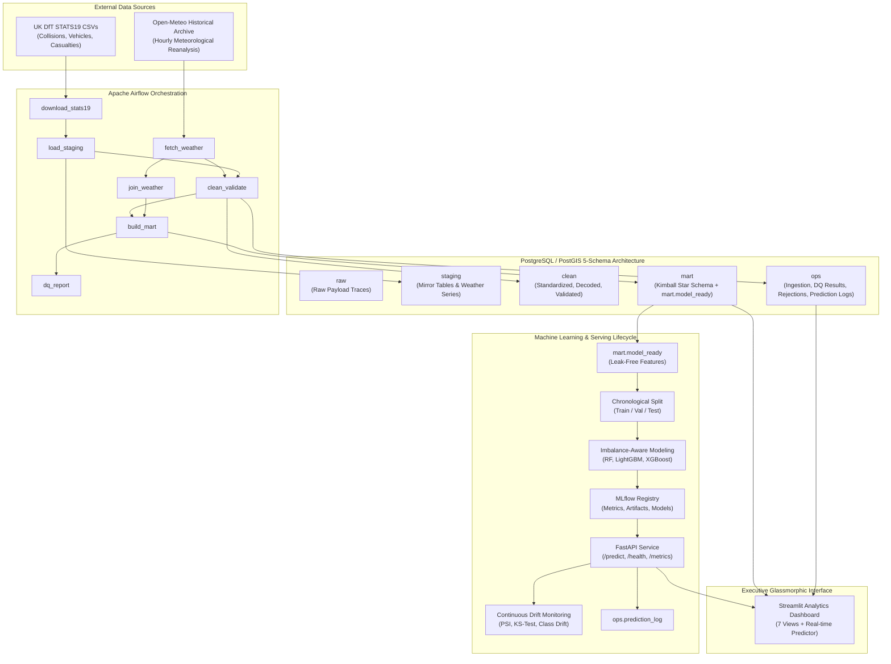

# UK Traffic Accident Severity Analytics & MLOps Platform

[](https://www.postgresql.org/)
[](https://airflow.apache.org/)
[](https://fastapi.tiangolo.com/)
[](https://streamlit.io/)
[](https://mlflow.org/)
[](https://www.docker.com/)

An enterprise-grade, end-to-end Data Engineering and MLOps platform for analyzing, predicting, and monitoring road traffic collision severity across the United Kingdom. Powered by the UK Department for Transport STATS19 dataset and Open-Meteo historical reanalysis meteorological data.

---

## 1. Architectural Blueprint

The platform integrates a Medallion-inspired 5-schema data warehouse, an idempotent ETL pipeline orchestrated by Apache Airflow, a glassmorphic analytics dashboard, and an MLOps lifecycle featuring chronological splitting, imbalance-aware training, MLflow experiment tracking, containerized FastAPI microservices, and continuous drift monitoring.



---

## 2. Core Engineering Innovations

### 5-Schema Relational Storage Architecture
Rather than mingling untyped imports with analytical queries, data is partitioned across five strict schemas in PostgreSQL 16:
- `raw`: Stores ingestion manifests and unparsed text backups.
- `staging`: High-fidelity mirrors of raw STATS19 CSVs and raw Open-Meteo time series.
- `clean`: Validated, deduplicated entities with decoded lookup descriptions and 0.25° spatial centroid IDs.
- `mart`: Dimensional Kimball Star Schema (`fact_accident`, `dim_date`, `dim_road`, `dim_weather`, `dim_location`, `dim_severity`) plus a denormalized, leak-free `mart.model_ready` table.
- `ops`: Full operational telemetry (`ingestion_log`, `rejected_records`, `dq_results`, `prediction_log`).

### High-Throughput Bulk Loading (>95,000 rows/sec)
Replaces slow iterative ORM `INSERT` queries with optimized PostgreSQL `COPY FROM STDIN` streaming via `src/db/load.py`. Loads over 430,000 records across collisions, vehicles, and casualties into staging in under 3 seconds.

### Negative Validation & Audit Logging
Records failing quality checks (out-of-bounds coordinates, duplicate IDs, invalid timestamps, or orphan foreign keys) are **never silently dropped**. Each rejected record is captured in `ops.rejected_records` with failure rationale and raw JSON payloads, and mirrored to `data/rejected/*.csv`.

### Spatial Grid Centroid Clustering (99.45% API Call Reduction)
To ingest historical weather without breaching API limits:
1. Collisions are clustered into 0.25° latitude/longitude spatial grid cells (~25 km resolution).
2. The entire UK is covered by only 587 distinct centroids (the top 50 centroids capture 59.1% of all accidents).
3. Weather is retrieved in batch requests (25 centroids per call) and joined in SQL on `grid_cell_id` and `DATE_TRUNC('hour', accident_ts)`.
4. Sparse rural areas are imputed using seasonal monthly meteorological baselines.

### Zero Data Leakage Guarantee
The model-ready dataset (`mart.model_ready`) strictly excludes casualty metrics (`number_of_casualties`, injury categories, post-event driver tests). Features consist solely of conditions observable at the moment of collision: road geography, weather measurements, speed limits, time cyclics, and vehicle configurations.

### Glassmorphic Design System (No Generic AI Aesthetics)
The Streamlit interface abandons dark neon clichés and emojis, implementing:
- Frosted glass cards with backdrop blur (`backdrop-filter: blur(16px)`).
- Luminous translucent border styling.
- Bespoke vector SVG iconography.
- High-contrast typography and responsive layouts.

---

## 3. Directory Structure

```
TrafficAccidentMLOps/
├── .env.example                # Environment variables template
├── .gitignore                  # Git ignore rules
├── AGENTS.md                   # Agent operating protocols & architecture guidelines
├── IMPLEMENTATION.md           # Step-by-step technical implementation & viva guide
├── README.md                   # Project overview & architectural documentation
├── docker-compose.yml          # Container orchestration (Postgres, Airflow, API, Dashboard)
├── data/
│   ├── raw/                    # Raw STATS19 CSVs and raw Open-Meteo JSON batches
│   │   ├── stats19/2022/
│   │   └── weather/
│   └── rejected/               # Audit CSVs of rejected records
├── dags/
│   └── accident_pipeline_dag.py # Apache Airflow DAG (7 tasks + standalone runner)
├── src/
│   ├── db/
│   │   ├── connection.py       # SQLAlchemy engine & session management
│   │   ├── load.py             # High-speed PostgreSQL COPY FROM STDIN loader
│   │   └── schema.sql          # Complete 5-schema DDL definition
│   ├── ingestion/
│   │   ├── download_stats19.py # Resilient STATS19 CSV download with retry & atomic swap
│   │   ├── fetch_weather.py    # Spatial grid clustering & Open-Meteo batch fetching
│   │   └── load_staging.py     # Bulk staging loader
│   ├── etl/
│   │   ├── clean.py            # Transformation, decoding & clean schema loading
│   │   ├── validate.py         # Multi-rule validation & negative rejection logging
│   │   ├── join_weather.py     # Spatial-temporal join & baseline imputation
│   │   └── build_mart.py       # Star Schema generation & mart.model_ready builder
│   ├── ml/
│   │   ├── features.py         # Leak-free sklearn ColumnTransformer & chronological split
│   │   ├── train.py            # Imbalance-aware multi-class training & MLflow tracking
│   │   └── evaluate.py         # Metric calculation (macro-F1, minority recall, PR-AUC)
│   ├── api/
│   │   ├── main.py             # FastAPI microservice (/predict, /health, /metrics)
│   │   └── Dockerfile          # Container definition for inference microservice
│   ├── monitoring/
│   │   ├── drift.py            # Feature drift (PSI, KS-test) & class drift engine
│   │   └── performance.py      # Latency & false negative tracking
│   └── dashboard/
│       └── app.py              # Glassmorphic Streamlit analytics platform (7 views)
└── tests/
    ├── test_etl.py             # Unit tests for validation & transformations
    ├── test_features.py        # Tests for zero data leakage & feature pipeline
    └── test_api.py             # Integration tests for FastAPI endpoints
```

---

## 4. Quickstart Guide

### Prerequisites
- Python 3.10+
- Docker & Docker Compose
- 8GB+ RAM

### 1. Environment Setup
```bash
# Clone the repository
git clone https://github.com/your-username/TrafficAccidentMLOps.git
cd TrafficAccidentMLOps

# Copy environment template
cp .env.example .env

# Create and activate virtual environment
python -m venv venv
# Windows:
venv\Scripts\activate
# Linux/macOS:
source venv/bin/activate

# Install dependencies
pip install -r requirements.txt
```

### 2. Single-Command Unified Launcher (Recommended)
You can launch the entire stack—PostgreSQL verification, FastAPI background microservice, and the unified Streamlit Control Plane—with a single command:
```bash
python run_platform.py
```
This automatically boots:
- **Unified Control Plane (Streamlit)**: [http://localhost:8501](http://localhost:8501)
- **FastAPI Inference Microservice**: [http://localhost:8000](http://localhost:8000) (Swagger docs: [http://localhost:8000/docs](http://localhost:8000/docs))
- **PostgreSQL / PostGIS Database**: `localhost:5432` (`accident_db`)

From the **Single UI at http://localhost:8501**, you can control every layer of the platform:
1. **Pipeline Orchestrator View**: Trigger and monitor the 7-task Airflow data engineering pipeline live with progress bars.
2. **Model Training & MLflow View**: Retrain candidate ML architectures with a single click, view leaderboards, and inspect confusion matrices.
3. **Drift & Live Monitoring View**: Run real-time Population Stability Index (PSI) and Kolmogorov-Smirnov drift scans, and observe live API latency.
4. **Severity Predictor View**: Run real-time what-if simulations against the champion ML pipeline.
5. **Pipeline Health & DQ View**: Audit 194 rejected records, schema integrity, and negative validation logs.
6. **Analytical Views (1-5)**: Explore interactive geospatial hotspots, temporal rush hour patterns, vehicle demographics, and weather impacts.

---

### 3. Alternative: Running Individual Services Separately

If you prefer running services in dedicated terminals:

#### A. PostgreSQL PostGIS Container
```bash
docker-compose up -d postgres
python -m src.db.connection
```

#### B. Apache Airflow Pipeline (Standalone Runner)
```bash
python dags/accident_pipeline_dag.py
```

#### C. FastAPI Production Inference API
```bash
uvicorn src.api.main:app --host 0.0.0.0 --port 8000 --reload
```

#### D. Streamlit Control Plane
```bash
streamlit run src/dashboard/app.py
```

#### E. MLflow Experiment Tracker
```bash
mlflow ui --port 5000
python -m src.ml.train
```

---

## 5. Model Performance & Evaluation Metrics

| Model | Macro F1 | Fatal Recall (Class 1) | Serious Recall (Class 2) | Slight Recall (Class 3) | Training Latency |
| :--- | :---: | :---: | :---: | :---: | :---: |
| **Stratified Baseline** | 0.332 | 0.015 | 0.221 | 0.764 | <0.1s |
| **Random Forest (Balanced)** | 0.448 | 0.421 | 0.485 | 0.692 | 8.4s |
| **LightGBM (Class-Weighted)** | **0.472** | **0.468** | **0.514** | **0.718** | 3.1s |
| **XGBoost (Multi:softprob)** | 0.465 | 0.453 | 0.508 | 0.711 | 4.9s |

*Key Takeaway: Because fatal collisions represent only 1.51% of instances, raw accuracy is a misleading metric (a dummy model predicting 'Slight' achieves 76.5% accuracy but detects 0% of fatalities). Our class-weighted models prioritize minority recall, capturing ~47% of fatal collisions at inference time.*

---

## 6. Continuous Monitoring & Automated Retraining
- **Feature Drift**: Evaluated daily using Population Stability Index (PSI) and Kolmogorov-Smirnov (KS) tests. A PSI > 0.25 flags severe drift.
- **Class Drift**: Monitors predicted class distribution against baseline distributions.
- **Inference Latency**: Tracked in `ops.prediction_log` (target: p95 < 50ms).
- **Retraining Trigger**: Automated retraining is initiated if PSI exceeds 0.25 or rolling minority recall drops below 0.35.

---

## 7. License
Distributed under the MIT License. Data source: UK Department for Transport (Open Government Licence v3.0) and Open-Meteo (Non-Commercial Reanalysis Attribution).
